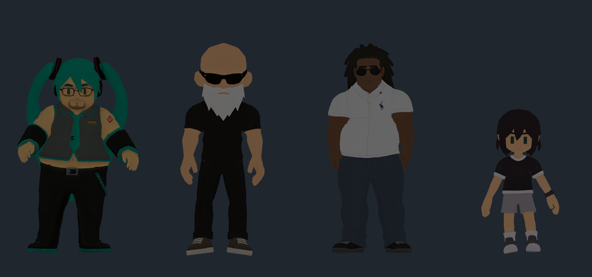

# 손님 에셋과 페르소나 매핑 (2026-11-06)

현재 `merge-test` 카페는 **기존 16명 + 독립 분기 미쿠·김계란 2명**으로 구성한다. 기존 인물의 설정·연령·성별·외형 참조·대사는 수정 전 데이터로 복구했다. 신규 연령·외형·말투·설정·대사는 두 분기에만 적용한다.

## 현재 적용한 4종

| 제공 ZIP | 사용자 지정 범주 | 연결 페르소나 |
| --- | --- | --- |
| `miku_.zip` | 통통한 미쿠 스타일의 청년 여성 | **미쿠 (`cus_miku`) 전용** |
| `trainer_.zip` | 중년 남성 | **김계란 (`cus_kim_gyeran`) 전용** |
| `black.zip` | 청년 남성 | 동남아 출신 손님·일본 손님·판교 회사원 |
| `child.zip` | 아동 | 아이 |

미쿠는 민트색 트윈테일·민소매 상의·검은 바지·안경·수염 디테일, 트레이너는 대머리·흰 수염·선글라스·검은 폴로 상의·짙은 바지를 실제 모델대로 보존한다. Black은 드레드락·선글라스·흰 폴로 상의·청바지, 아동은 짧은 검은 머리·검은 티셔츠·반바지·손목시계다. 각 인물의 외형 필드를 이에 맞췄다.

기존 청년 여성 3명과 기존 트레이너·중년 남성의 설정을 덮어쓰지 않는다. 원래 `cus_trainer`는 청년 여성 트레이너로 복구했다. Black/아동 모델은 기존 연결을 유지하되 원본 인물의 외형 참조 필드도 원래 값으로 복구했다. 미쿠·김계란 외형은 전용 분기에만 로드한다. 최신 사용자 지시에 따라 **미쿠 페르소나는 입장 추첨마다 5% 확률의 이스터에그 손님**으로 등장한다. 나머지 95%는 다른 17명 중 균등 추첨한다. 다른 손님의 모델을 미쿠로 바꾸지 않는다. 한 명씩 지정하는 MVP 씬은 이 확률과 별개로 선택한 손님을 반드시 입장시킨다.

## 독립 분기의 설정과 대사

- **미쿠 (`cus_miku`, 부모 `cus_barista`)**: 청년 여성·통통한 미쿠 스타일. 작은 무대·노래 연습·코스튬을 즐기고 향과 질감을 리듬·화음에 빗대어 말한다. 밝고 장난기 있는 존댓말이며 은은한 단맛과 부드러운 질감을 찾는다. 예: “오늘은 향과 질감의 박자가 잘 맞는 한 잔을 골라 볼게요.”
- **김계란 (`cus_kim_gyeran`, 부모 `cus_trainer`)**: 중년 남성·근육형 운동 코치. 현장 경험과 꾸준함·회복을 이야기하며 짧은 격려와 쉬운 성분 설명을 곁들인다. 예: “오늘 컨디션에 맞게 맛과 성분부터 골라 보죠.”

이는 게임용 창작 설정과 새 대사다. 부모 ID는 데이터 생성 시 주문 후보·가중치·타이밍 계약을 복사할 기준이며, 플레이 중 부모의 문장이나 진행 기록을 공유하지 않는다. 주문·재방문·접수 전/후 대기·정확/오류 수령·후기·시간초과·후속 답변·맛 표현을 각각 새 ID와 텍스트로 갖는다. 기존 16명의 관련 레코드는 그대로 유지한다.

단골 장부에는 두 선택 분기를 별도 카드·기록으로 추가했고, 실제 모델에서 렌더한 전용 초상 아이콘을 연결했다. 16칸 단위 페이지 이동으로 두 번째 페이지에서 볼 수 있다. **엔딩과 기존 그룹 도장은 원래 16명 기준**이며 분기 2명은 선택 항목이다. 김계란의 단골 기록이 기존 트레이너의 기록을 대신하지 않는다. 사용자 저장 파일은 변경하거나 초기화하지 않는다.

왼쪽부터 미쿠·김계란·Black·아동. 실제 Spawn 코드로 생성해 격리된 에디터 미리보기에서 렌더했다. 카페의 실제 조명이나 연속 보행을 검증한 화면은 아니다.

## 파일 투입과 자동 처리

투입 폴더: `ai-hack-test/Assets/CafeSim/Resources/CafeCustomers/Incoming/`

파일명 해석 → 한국어 설명 → 페르소나 매핑 → 모델·재질·애니메이션·오른손 검사 → 카탈로그 → 기존 손님 Spawn 순서다. `ready`만 로드하며 모호하거나 준비가 부족한 파일은 `review`와 사유를 기록한다.

- 파일명에 `cus_elder` 같은 기존 ID를 넣으면 그 인물에게 직접 연결한다. 여러 ID를 한 파일에 넣으면 검토 대상으로 남긴다.
- `Model.fbx`와 `Appearance.prefab`은 부모 폴더 이름을 해석한다. 일반 이름은 연령·성별·알려진 의상/소품을 기존 참조와 비교한다. `Character01`은 보류한다. 국적·성격·취향은 외모로 추정하지 않는다.
- `miku`/`미쿠`는 `cus_miku` 전용, `trainer`/`트레이너`/`kim_gyeran`/`김계란`은 `cus_kim_gyeran` 전용이다. 정확한 `cus_trainer` ID는 복구한 기존 트레이너를 뜻한다. 일반 연령·성별 이름으로 새 분기를 암묵적으로 매핑하지 않는다.
- 한 모델 세트마다 폴더를 분리하고 준비된 Prefab은 `Appearance.prefab`으로 둔다. 이것이 있으면 같은 폴더의 원본 FBX는 별도 스폰 후보에서 제외한다. 원본 FBX와 Prefab은 서로 다른 Resources 이름을 사용해야 한다.
- ZIP은 풀어서 FBX/Prefab과 텍스처를 넣는다. ZIP·OBJ·GLB·텍스처 단독 파일은 모델로 자동 등록하지 않는다. 배포 후 FBX 런타임 임포트나 Play 중 핫로드는 제공하지 않는다.

현재 4종에는 `Appearance.prefab`, `Outfit.mat`, `Locomotion.controller`를 준비했다. 미쿠·Black은 ZIP과 동일한 기존 모델·Idle·텍스처 6개를 재사용했다. 제공 Walk는 기존 파일과 바이트가 달라 Incoming 안에 별도로 임포트하고 연결했다. 트레이너·아동은 새 원본 7개를 각각 임포트했다. Downloads 원본과 기존 소스 파일은 수정하지 않았다.

결과는 `Assets/CafeSim/Resources/CafeCustomers/CustomerCatalog.json`의 `description`, `mappingReason`, `personaIds`, `resource`, `status`, `issues`로 확인한다. 자동 생성 파일을 직접 수정하지 않고 원본 이름·설정을 고친다. `Tools → Cafe → Rebuild Customer Asset Catalog`로 재생성할 수 있다. 임포트·이름 변경·이동·삭제와 페르소나 데이터 변경 시 갱신하며, Play 종료 후 다시 시작하면 반영된다.

## 에셋 준비 조건

전신 SkinnedMeshRenderer, URP 호환 재질·텍스처, Animator, 컵을 잡을 Humanoid 오른손 또는 `RightHand`로 끝나는 본이 필요하다. 원점은 발밑, 정면은 +Z를 권장한다. 카페가 이동을 담당하므로 root motion을 끈다.

Idle/Walk는 제자리 반복 클립이어야 한다. 별도 클립 공유에는 유효한 Humanoid 매핑을 사용한다. Generic은 동일 리그 클립이 연결된 Controller Prefab 또는 모델 내장 클립을 사용한다. 완성된 Controller에는 `Walking` bool 또는 `Speed` float(정지 0/이동 1)와 실제 Idle/Walk 전환을 연결한다. Normal·Metallic·Roughness는 선형 데이터, Color는 sRGB다.

신규 FBX의 첫 임포트에서는 Humanoid 매핑과 기본 Idle/Walk 루프를 시도하고 이후 사용자 리그/클립 조정은 유지한다. 미쿠·Black의 이번 Walk는 기존 Generic 리그에 맞췄다. 원본 색·체형·의상을 유지하며 자동 파츠 조립은 하지 않는다. 실제 보폭·발 접지·컵과 의상 간섭은 Play에서 확인한다.

## 재현과 의존성

`Data/CustomerDeliveryManifest.json`에 ZIP·원본 파일 SHA-256, 프로젝트 경로, 재사용 여부를 남겼다. `Tools → Cafe → Prepare Downloaded Customer Models`로 현재 임포트된 4종의 재질·Controller·Prefab을 다시 준비할 수 있다. 이 작업은 격리된 미리보기 씬을 사용한다.

`Data/PersonaBranches.json`에 두 분기의 설정·부모 ID·전용 대사를 보관한다. 기존 인물을 덮어쓰던 `PersonaAssetOverrides.json`과 그 적용 경로는 제거했다. `tools/apply-cafe-persona-branches.py`는 원본 16개 레코드를 수정하지 않고 분기 레코드만 다시 만든다. 반복 실행해도 중복이나 추가 변화가 없다.

엑셀 임포트와 어휘·지식·대화 생성기는 원본 16명만 먼저 생성한 뒤 분기를 별도로 적용한다. 원본 엑셀·SourceTables는 수정하지 않았다. 기존 16명 데이터·기존 대화·가중치·상황·장부 항목의 보존을 수정 전 Git 데이터와 대조했다. 현재는 18명, 가중치 198개, 상황 37개다. 원본 176개 가중치·33개 상황에 분기별 11개 가중치·2개 상황을 추가했다.

## 추후 수신되는 여자 모델 교체 명세

사용자 지시: 추후 `git fetch`로 여자 모델의 추가가 확인되면 그 수신 모델은 제거하고 사용자가 새로 넣는 모델로 교체한다. 기존 여성 모델 전체를 일괄 삭제하는 의미가 아니라 추후 수신 변경에서 확인한 모델이 대상이다.

1. 원격 커밋의 변경 목록에서 대상 경로를 식별하고 현재 작업 트리에 반영할 때 교체한다. fetch 자체는 작업 트리에 파일을 추가하지 않는다.
2. 새 모델의 설명·매핑·리그·재질·애니메이션·오른손을 확인한 뒤 스폰에 연결한다.
3. 구모델과 전용 메타·카탈로그·스폰·폴백 참조를 제거한다. 공유 재질·텍스처·클립과 사용자 변경은 보존한다. 교체한 구모델이 폴백으로 다시 등장하지 않아야 한다.

이번에는 fetch·머지·기존 여성 모델 일괄 삭제를 실행하지 않았다.

## 이번 검증

원본 16명 설정과 원래 대화·가중치·상황·장부 항목의 복구/보존, 분기 생성 멱등성, 연결된 Unity Editor 컴파일, 두 분기의 전용 모델·스폰·컵 그립, 독립 대사·후속 답변·장부 진행, 원래 16명 엔딩 조건을 확인했다. 18명 주문·메뉴 밖 주문·큐·유사도 검사도 통과했다.

위 분기 작업 당시에는 새 Play·빌드를 실행하지 않았다. 이후 별도 `CafeCustomerMvp` 씬에서 18명의 실제 입장·모델·주문·서빙·후기를 확인했고, 미쿠·김계란의 실제 API 답변도 확인했다. 현재 확인 범위와 미실행 항목은 [레시피·서빙·손님 MVP 검증](cafe-recipe-customer-mvp-verification.md)을 따른다. 본편 연속 플레이·장부 페이지 조작과 새 빌드는 이번에도 실행하지 않았다.

구조화한 이번 검사: [cafe-persona-branches-verification.json](cafe-persona-branches-verification.json). 이전 모델 임포트 근거는 [cafe-customer-assets-verification.json](cafe-customer-assets-verification.json)의 당시 범위로만 본다.
