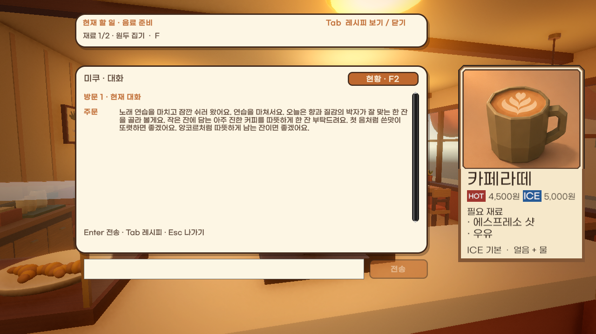
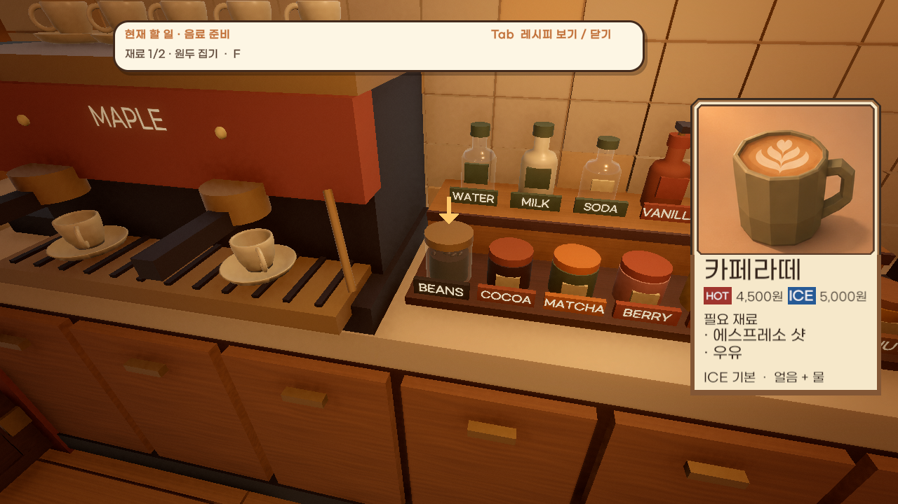
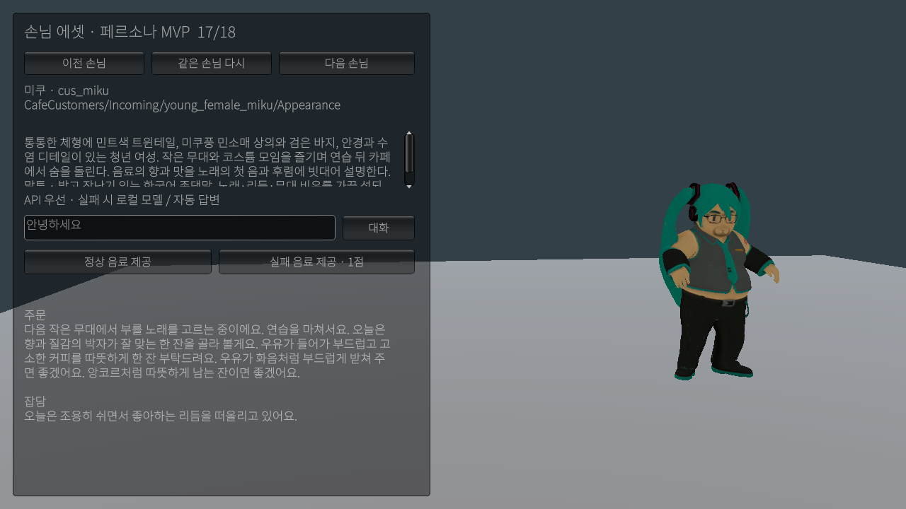
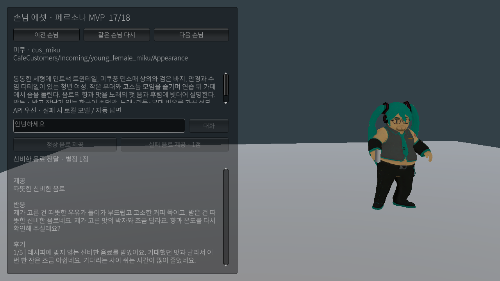

# 레시피·서빙·손님 MVP 검증 (2026-11-06)

## 제공 동작

- Tab 레시피 목록에서 고른 카드를 화면 오른쪽의 독립 영역에 고정한다. 1280×720 기준 카드 영역은 x=984~1256, y=140~565이며 현재 할 일·대화창은 x=160~920을 사용한다. 화면 비율이 달라져도 같은 1280×720 기준 영역을 맞춰 사용한다. 손님 말풍선도 카드 영역을 피한다.
- 선택한 레시피와 현재 손님 주문의 온도를 기준으로 다음 작업을 안내한다. 원두 집기 → 분쇄 → 추출 → 제조 컵에 넣기, 다른 재료 집기/넣기, ICE 얼음물 준비, 블렌딩 → 머그잔 → 들기 → 서빙 순서를 실제 제조 상태에서 읽는다. 순서가 끝나면 다음 안내로 바뀌고, 다른 재료가 섞이면 싱크대에서 다시 시작하도록 안내한다. 카메라 앞에 보이는 대상 위에는 아래쪽 화살표를 표시하고 화면 밖 대상은 둘러볼 방향을 알려 준다.
- 신비한 음료도 F로 손님에게 건넬 수 있다. 메뉴 주문/메뉴 밖 주문, 온도, 대기 시간과 관계없이 정상적으로 전달된 실패 음료는 **1점**이다. 이미 떠난 손님·중복 제공은 허용하지 않는다. 시간초과는 기존 0점 판정을 유지한다. 장부도 제공 실패·판매액/팁 0·재료 손실로 집계한다.
- 미쿠는 매 입장 추첨에서 **5%**, 나머지 손님은 나머지 95% 안에서 균등 추첨한다. 외형만 바꾸는 방식이 아니라 `cus_miku`의 모델·설정·대사가 함께 등장한다. 기존 16명과 김계란 분기는 유지한다. 미쿠가 없는 출연진과 손님 한 명을 고정한 MVP에는 일반 선택 규칙을 적용한다.

## 별도 MVP 사용

`Assets/Scenes/CafeCustomerMvp.unity`를 열고 Play한다. 본편 빌드 씬 목록에는 추가하지 않았다. 미쿠부터 표시하며 이전/다음/같은 손님 버튼으로 18명을 지정할 수 있다. 실제 `CafeSession`, 카탈로그 스폰, 이동, 주문, 대화, `CafeServeCounter`, 후기 경로를 사용한다. 본편 영업일·장부·단골 저장은 실행하지 않는다.

왼쪽에서 설정·말투를 스크롤해 읽고 질문을 입력해 대화할 수 있다. 손님이 카운터에 도착하면 정상 음료 또는 실패 음료를 제공한다. 손에 연결된 테스트 머그잔과 반응·후기를 확인한다. 실제 API → 로컬 → 자동 답변 경로는 기존 게임 설정을 사용하며, 사용한 답변 경로를 표시한다. 새 인증정보나 모델 다운로드는 추가하지 않았다.

## 실제 확인

| 항목 | 결과와 근거 |
| --- | --- |
| 현재 코드 컴파일 | 연결된 Unity 6000.6.8f1 Editor 컴파일 통과 |
| 레시피/UI 화면 | 본편을 Play하지 않은 임시 에디터 미리보기에서 실제 카드·현재 할 일·대화 UI를 렌더. 1280×720, 1024×768, 2560×1080에서 카드 전체 표시·영역 분리를 확인 |
| 위치 안내 | 실제 제조대의 원두 대상 위 아래쪽 화살표 렌더 확인. 명령은 실행하지 않는 읽기 전용 안내 |
| 제조·실패 계약 | `tools/cafe-service-guidance-check.cs`: 카드 재료와 실제 완성 음료 일치, 샷 준비·ICE 기반·블렌딩·머그·오류 복구의 대상 전환, 실패 1점·장부·잘못된/중복/늦은 제공 거절 확인 |
| 미쿠 확률 | 같은 검사에서 0≤추첨값<0.05인 경우 미쿠, 0.05≤추첨값<1인 경우 다른 손님, 다른 17명 선택 가능, 단독 MVP 및 미쿠 없는 출연진 확인. 유한한 플레이의 실제 출현 비율이 정확히 5%여야 한다는 의미는 아님 |
| 18명 실제 Play | 별도 MVP에서 전원 선택 → 입장/카운터 도착 → 지정 모델·메시 확인 → 주문/페르소나별 자동 답변 검색 → 정상/실패 음료 전달 → 손의 머그·후기 표시 확인 |
| 4종 에셋 | 미쿠·김계란 전용 모델, Black의 동남아/일본/판교 손님 연결, 아동 모델의 아이 연결. 기존 트레이너는 기존 여성 외형으로 유지 |
| 실시간 대화 | 미쿠의 노래 연습 질문과 김계란의 운동 후 휴식 질문이 실제 API 답변을 반환. 각각 약 0.85초/1.09초이며 그 질문에서 관찰한 값임 |
| 기존 데이터 | `cafe-data-check.cs`, `cafe-persona-branch-check.cs` 통과. 원래 인물·독립 분기·16명 엔딩 조건·주문/메뉴 밖 주문 보존 확인 |
| 참조 | CafeGame 및 MVP 씬에 Missing Script 0. 추가 에셋 GUID/참조 확인. 패키지 두 파일의 SHA-256 및 ProjectSettings 변경 없음 |

손님 Play 검사는 코드로 선택·서빙 버튼과 동일한 메서드를 호출한 것이다. OS 마우스/키보드 입력을 직접 조작한 검사가 아니다. 본편의 연속 제조·카드 선택 애니메이션·F키 조작·화살표를 따라가는 체감·IME·장부 페이지 이동은 사용자 Play 확인이 남아 있다. 새 플레이어 빌드와 다른 PC 실행은 하지 않았다. 임시 미리보기와 Game View 크기는 정리했고 최종 Editor는 MVP 씬의 Play 정지 상태다.

구조화한 결과와 전원 스폰 기록: [cafe-recipe-customer-mvp-verification.json](cafe-recipe-customer-mvp-verification.json).
