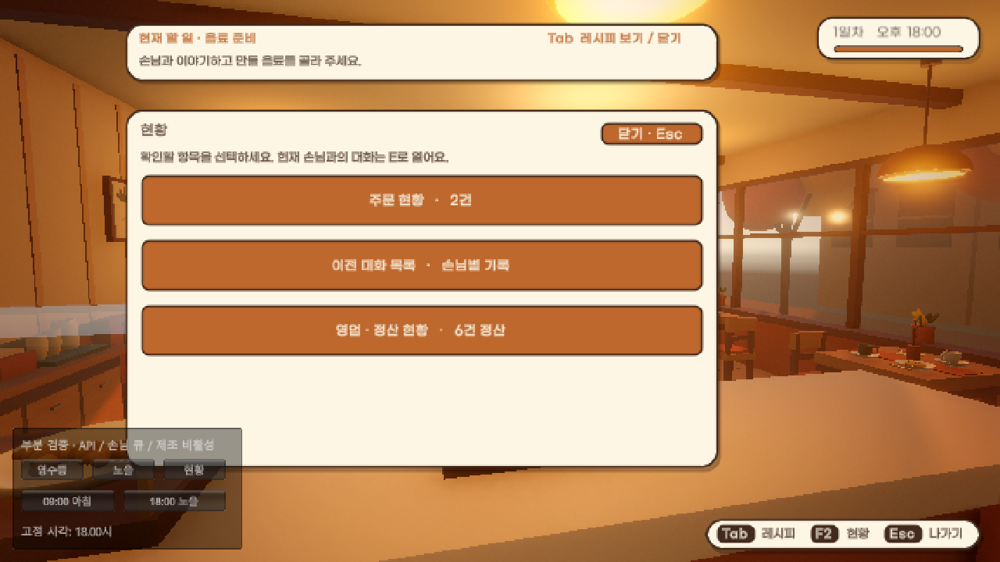
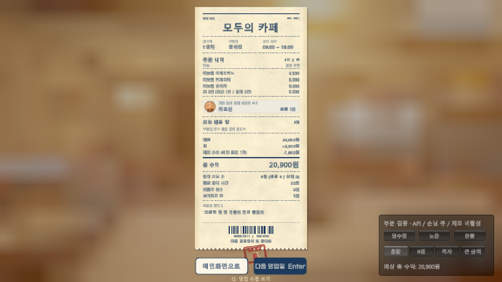
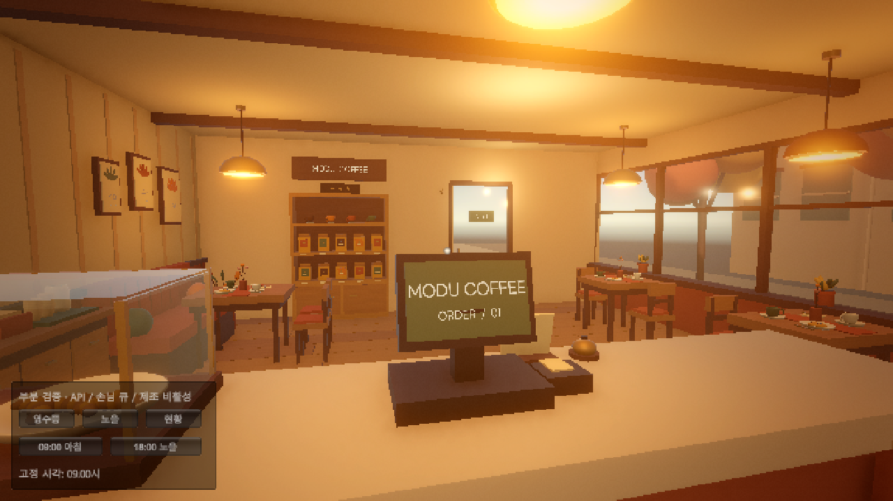
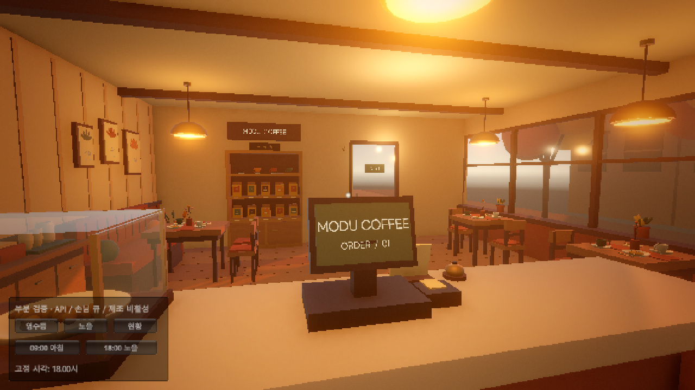

# 현황 통합 · 영수증과 18시 노을 부분 검증

2026-11-06, Unity 6000.6.8f1. 이전 작업 `71ed4ef5` 위에서 현황 UI를 통합하고 별도 씬을 검증했다.

## 플레이에서의 흐름

- **E**: 현재 방문에서 진행 중인 손님 대화와 입력창만 표시한다. 같은 손님의 이전 방문도 현황에서 확인한다. 입력 중 E는 글자로 취급하고 Esc로 닫는다.
- **F2 현황**: 주문 현황 / 이전 대화 목록 / 영업·정산 현황을 선택한다. 항목을 선택하면 상세가 열린다.
- **Esc**: 상세 → 상위 목록 → 현황 첫 화면 → 게임 순서로 나온다.
- 현황에서 연 대화는 현재 손님의 기록이어도 읽기 전용이다. 입력하려면 E로 현재 대화를 연다.
- 과거 주문·대화를 열어도 현재 서빙 대상은 바뀌지 않는다. 진행 중 주문에는 숨긴 메뉴 정답 대신 손님이 실제로 한 부탁을 표시한다.

## 별도 씬 열기

`Assets/Scenes/CafeReceiptSunsetTest.unity`를 열거나 **Cafe → 검증 → 정산·노을 부분 씬 열기**를 선택한 뒤 Play한다.

이 씬은 기존 카페의 배경과 실제 `CafeHud` 영수증·`CafeDayLedger`·`CafeDaylight`를 사용한다. API/로컬 모델, 손님 큐 진행, 제조, 차량은 비활성화한다. 기본 빌드 씬 목록에는 추가하지 않았고 검증 컴포넌트는 Editor 전용이다. 현재 게임의 엔딩이나 영업 진행을 자동으로 시험하는 오브젝트를 정상 씬에 연결하지 않는다.

오른쪽 아래 검증 패널에서 영수증 / 노을 / 현황을 고른다. 영수증은 혼합·0원·적자·큰 금액, 노을은 09:00·18:00을 선택할 수 있다. 영업 시간은 고정되고 실제 API 키는 읽거나 호출하지 않는다. 함께 열려 있던 Editor 씬은 Play 중에만 비활성화하며 저장 상태를 바꾸지 않는다.

## 영수증 확인

실제 Ledger에 합성 주문을 넣고 화면의 매출·팁·손실·총 수익을 계산값과 대조했다. 계산만 통과시킨 것이 아니라 실제 Game 화면에서 금액 전체, 쉼표, 음수 부호와 원 표기를 확인했다. 경우를 바꾸었을 때 앞선 금액이 남지 않는 것도 확인했다.

| 경우 | 매출 | 팁 | 손실 | 총 수익 표시 |
| --- | ---: | ---: | ---: | ---: |
| 정상 4건 + 잘못 제공 1건 + 시간 초과 1건 | 20,000 | 2,500 | 1,600 | **20,900원** |
| 주문 없음 | 0 | 0 | 0 | **0원** |
| 잘못 제공 2건 | 0 | 0 | 3,200 | **-3,200원** |
| 큰 금액과 실패 혼합 | 3,580,100 | 2,000 | 1,600 | **3,580,500원** |

[0원](images/cafe-status-receipt/receipt-empty.png) · [적자](images/cafe-status-receipt/receipt-loss.png) · [큰 금액](images/cafe-status-receipt/receipt-large.png)

## 18:00 노을 확인

같은 카페·카메라에서 실제 `CafeDaylight`를 09:00과 18:00으로 고정해 비교했다. 18:00은 64,800초이며 태양 색 `(1, 0.51, 0.27)`, 강도 `1.3`이다. 창가 빛과 실내 표면의 따뜻한 색 변화가 실제 렌더에서 확인됐다. 하루 전체를 기다리는 테스트나 정산으로의 실제 시간 경과 전환 검증은 아니다.

## 범위와 복구

현황 선택·이전 대화 읽기 전용·E 입력 허용·상위 목록 복귀를 실제 HUD와 합성 방문으로 확인했다. 물리 키보드/OS IME 입력, 실제 모델 답변, 하루 전체의 주문·정산 루프와 새 플레이어 빌드는 이번 검사에 포함하지 않았다. 검사 후 Play를 종료하고 원래 MainMenu로 돌아왔으며 수집 저장 파일과 빌드 씬 목록이 바뀌지 않은 것을 확인했다.

중간 Editor 스크립트 리로드로 초기화된 검증 상태와 잘못 남은 Game 화면은 통과 근거에서 제외했다. 검증 씬은 리로드 시 합성 상태를 다시 준비하고, HUD는 사라진 UI 텍스처/스타일을 다시 생성하도록 보완했다.

구조화한 기록: [cafe-status-partial-verification.json](cafe-status-partial-verification.json).

커밋에 포함할 파일만 별도로 추출하여 Unity 참조/정의와 Roslyn으로 런타임 43개, Editor 6개 소스를 다시 컴파일했고 모두 통과했다. 미커밋 상태의 별도 손님 외형·페르소나 소스를 포함하지 않은 검사다. 플레이어 실행 파일을 만든 검사는 아니다.

## cafe-game 최신 커밋 통합

PR 병합 중 대상 브랜치에 추가된 `4dd2b6e7`(첫날 튜토리얼, 마감 Enter, 시작 전환 입력)을 함께 반영했다. 대화 중 레시피 Tab 토글과 현황의 읽기 전용 처리를 유지했다. 마감 후 현황이 열린 동안 Enter가 뒤의 영수증을 진행하지 않도록 차단했다.

통합 소스만의 런타임·Editor 컴파일과 Unity 재컴파일이 통과했다. 부분 씬에서 튜토리얼 Tab 안내의 일시정지 → 카드 열기·재개, 시작 전환 마지막 프레임의 입력 차단, 현재 대화 입력 허용과 기록 입력 차단, Esc 복귀를 메서드 호출로 확인했다. 마감 상태에서 현황이 열리면 다음 날 진행 요청이 생성되지 않는 것도 확인했다. 실제 화면의 혼합 영수증은 20,900원과 새 Enter 버튼 문구를 표시했으며 18:00 노을 화면도 유지됐다. 최종 콘솔 오류 0개, Play 종료 후 MainMenu 복귀와 수집 저장 파일 해시 보존을 확인했다. 물리 키보드를 이용한 전체 영업 루프는 이 추가 검사에도 포함하지 않았다.
